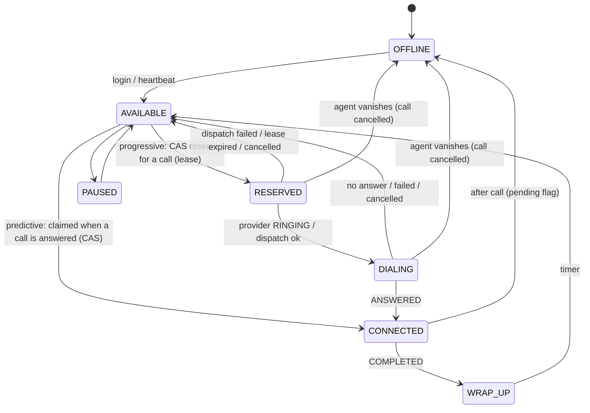
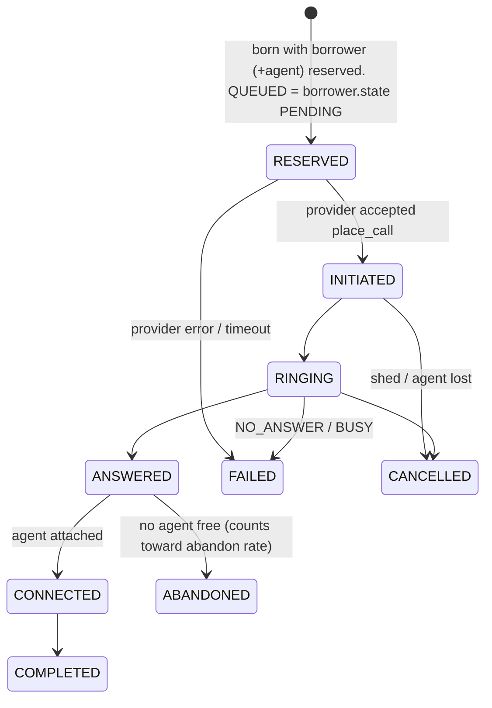

# Architecture

## Components

```mermaid
flowchart LR
  subgraph Worker["Dialer worker (N identical, stateless)"]
    P[Pacing Engine<br/>pure: Snapshot+Stats -> DialRequest]
    S[Safety Controller<br/>approve / reduce / reject / fallback / shed]
    A[Call Allocator<br/>needs HMAC-sealed decision]
    D[Dispatcher<br/>place_call outside the DB tx]
    P -->|request| S -->|sealed decision| A -->|RESERVED rows| D
  end
  DB[(Database<br/>source of truth)]
  A <--> DB
  S -. reads stats .-> DB
  D -->|place_call(call_ref)| PRV{{TelecomProvider interface}}
  PRV --> PA[Mock A: fast, reliable]
  PRV --> PB[Mock B: slow, timeouts,<br/>dupes, out-of-order]
  PRV -. webhooks .-> EH[Event Handler<br/>idempotent, monotonic]
  EH <--> DB
  R[Reconciler<br/>redrive, status poll, orphan repair] <--> DB
  R --> PRV
  O[Outbox<br/>hangups] <--> DB
  D --> O
```

One cycle (per worker, ~1/s): `BEGIN; lock campaign row; tick timers; snapshot; stats; pace; safety review; allocate; log decision; COMMIT;`
then dispatch every new call to the provider **outside** the transaction.
Snapshot -> decide -> reserve is one atomic unit, so two workers can never both act on the same stale view.

## Agent state machine



## Call state machine (events may only move a call forward)


Rank: RESERVED 1 < INITIATED 2 < RINGING 3 < ANSWERED 4 < CONNECTED 5 < {COMPLETED, FAILED, CANCELLED, ABANDONED} 6.
An event is applied only if `rank(target) > rank(current)`; otherwise it is stored and ignored. That one rule covers
duplicates and reordering for any provider.

## Safety controller guarantees

| # | Guarantee | How |
|---|---|---|
| G1 | Deterministic floor | `bind_agents=True`: agent reserved *before* the call is placed -> cannot be abandoned |
| G2 | Bounded overdial | speculative calls U capped so `E[max(0,Bin(U,p_up)-F_safe)]/(U*p_up) <= target`; `p_up` = upper confidence bound on answer rate; `F_safe` counts only agents we can trust to be free |
| G3 | Feedback | measured abandon rate over the last 400 answered calls scales the target to 0 and forces G1 at 80% of the cap |
| G4 | Hard gates | calling hours (IST), provider circuit breaker + half-open probe, absolute caps, shed on exposure breach |
| G5 | Non-bypassable | decisions are HMAC-sealed with a secret only controller and allocator hold; test proves `pacing.py` cannot import telecom/allocator/db |

## Failure matrix

| Failure | What happens | Where it is proven |
|---|---|---|
| Two workers want the same agent | CAS `UPDATE ... WHERE state='AVAILABLE' AND version=?`; one rowcount==1 | `test_concurrency.py` |
| Worker dies after reserve/place_call | rows stay RESERVED; reconciler re-dispatches after lease; provider dedupes on `call_ref` | `demo_worker_crash` |
| ANSWERED x3, COMPLETED | one transition each; replays hit UNIQUE key | `demo_duplicate_events` |
| COMPLETED, ANSWERED, RINGING | COMPLETED applies; the rest stored as ignored | `demo_out_of_order` |
| Crash after ANSWERED applied | event + state in one tx -> both roll back; redelivery re-applies | `demo_out_of_order` (5b) |
| Provider API times out | call FAILED w/o burning borrower attempt, defensive hangup via outbox, breaker opens, traffic fails over, half-open probe closes it | `demo_provider_outage` |
| Provider goes fully dark | stuck calls polled, then force-closed after hard timeout; agents/borrowers freed | `demo_provider_blackout` |
| 40 of 100 agents vanish | next cycle: approved=0, excess ringing calls shed | `demo_agent_drop` |
| Agent vanishes during setup | call cancelled, borrower requeued (attempt not consumed), late ANSWERED ignored | `demo_agent_disappears_during_setup` |
| Answer rate 70% -> 10% | over-estimating p only under-dials (utilization dip, not a safety event); short-window blend corrects within ~15 attempts | `test_answer_rate_crash_is_safe` |
| Answer rate 10% -> 70% | the dangerous direction: `p_up` takes the max of long/short-window upper bounds; abandon feedback throttles | scenario D |
| DB says AVAILABLE, cache says RESERVED | there is no cache: the DB row is the only truth | ADR-2 |
